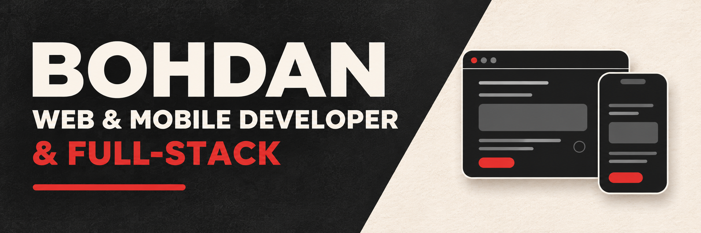

# Hello, world! 👋

I build landing pages, company websites, and e-commerce sites. For websites, I work with Astro and content management systems like WordPress. For web apps, dashboards, and customer portals, I use React and Next.js.

On mobile, I build Flutter apps for iOS and Android.

On the backend, I write server-side code in Node.js and PHP. I’m expanding my full-stack experience with NestJS and PostgreSQL.

If you’re planning a website, web app, or mobile app, let’s talk. I can also help with a project you already have, whether you need to add a feature, connect an external service, fix a bug, or speed things up.

I’m also open to joining a team as a web or mobile developer.
